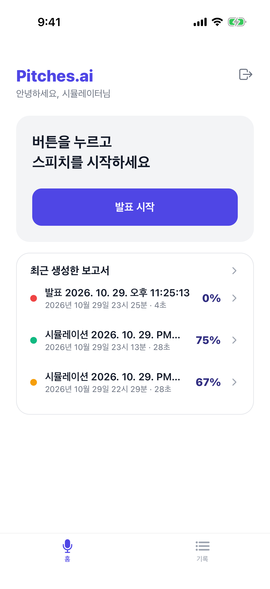
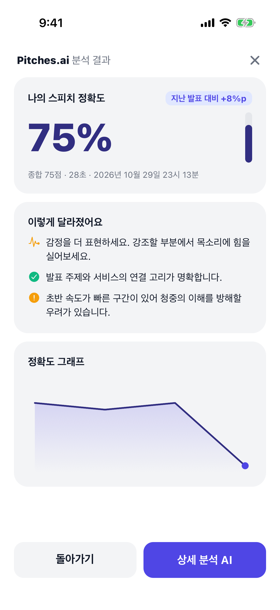
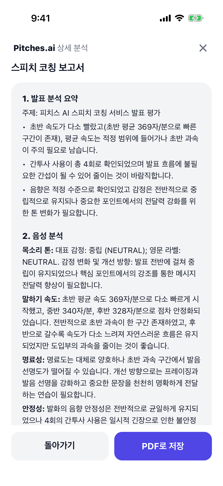
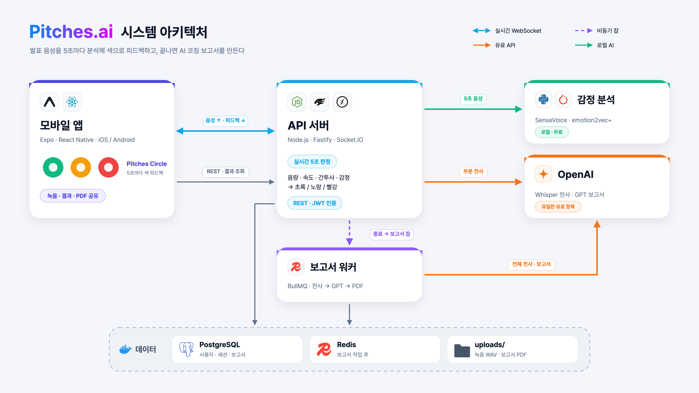

<div align="center">

# 🎤 Pitches.ai

**말하는 동안 5초마다 피드백하는 AI 스피치 코치**

발표 음성을 실시간으로 분석해 **초록 · 노랑 · 빨강** 색과 한 줄 팁으로 바로 알려주고,<br/>
발표가 끝나면 강점 · 약점 · 개선 로드맵이 담긴 **AI 코칭 보고서(PDF)** 를 만들어 줍니다.


<br/>

<table>
  <tr>
    <td align="center"></td>
    <td align="center"></td>
    <td align="center"></td>
    <td align="center"></td>
  </tr>
  <tr>
    <td align="center"><b>홈</b></td>
    <td align="center"><b>실시간 분석</b></td>
    <td align="center"><b>분석 결과</b></td>
    <td align="center"><b>AI 코칭 보고서</b></td>
  </tr>
</table>

</div>

> 2025 SW중심대학 AI 창업 아이디어 경진대회 출품 아이디어를 실제로 동작하는 서비스로 구현한 프로젝트입니다.

## ✨ 주요 기능

| | 기능 | 설명 |
|---|---|---|
| 🟢 | **Pitches Circle** | 5초마다 말하기 속도 · 음량 · 간투사 · 감정을 판정해 원의 색과 한 줄 팁으로 즉시 피드백 |
| 💬 | **실시간 자막** | 지금 말한 문장을 한 문장씩 보여주고, "음 · 어" 같은 간투사를 강조 |
| 🧠 | **음성 감정 분석** | SenseVoiceSmall + emotion2vec+ 를 로컬 CPU 에서 실행 — 긴장 · 슬픔 등을 감지하고 웃음 · 박수 같은 소리도 인식 |
| 📝 | **AI 코칭 보고서** | 전체 전사 → 지표 집계 → GPT 구조화 보고서 → 한글 PDF. 공유 시트로 저장 · 전송 |
| 📈 | **기록 · 정확도 추이** | 발표마다 정확도를 기록하고 그래프로 성장 과정을 확인 |

## 🏗️ 아키텍처

<p align="center">
  
</p>

1. 앱이 마이크 음성(16kHz PCM)을 250ms 단위로 Socket.IO 로 보냅니다.
2. 서버가 5초씩 모아 음량을 재고, **Whisper 부분 전사**(속도 · 간투사 · 자막)와 **감정 분석 서비스**를 병렬로 호출합니다.
3. 걸린 이슈 개수에 따라 🟢 0개 · 🟡 1개 · 🔴 2개 이상으로 판정해 앱에 돌려줍니다.
4. 발표가 끝나면 BullMQ 워커가 전체 전사 · GPT 보고서 · PDF 를 비동기로 만듭니다.

구성 요소, 설계 판단, 알려진 한계는 [`docs/architecture`](docs/architecture/README.md) 에 정리돼 있습니다. ([상세 다이어그램](docs/architecture/pitches-architecture.png))

## 🧰 기술 스택

| 영역 | 기술 |
|---|---|
| **모바일** | Expo SDK 55 · React Native 0.83 (New Architecture) · Expo Router · Zustand · TanStack Query · socket.io-client · @siteed/audio-studio · react-native-svg |
| **API 서버** | Node.js · Fastify 5 · Socket.IO 4 · Prisma 5 · JWT + bcrypt · zod |
| **보고서 워커** | BullMQ · OpenAI Whisper · gpt-5-nano · pdfkit + Pretendard |
| **감정 분석** | Python 3.12 · FastAPI · FunASR · PyTorch (CPU) · SenseVoiceSmall · emotion2vec+ base |
| **데이터** | PostgreSQL 16 · Redis 7 (Docker Compose) · 로컬 파일 저장소 |
| **개발** | Yarn Berry 4 workspaces · vitest · pytest · XCUITest |

## 🚀 시작하기

### 준비물

- Node.js 22+ · Yarn 4 (`corepack enable`)
- Docker Desktop
- [uv](https://docs.astral.sh/uv/) — 감정 분석 서비스용 (`brew install uv`)
- Xcode (iOS) · Android Studio (Android)
- OpenAI API 키

### 설치

```bash
yarn install

# API 는 apps/api 폴더에서 실행되므로 .env 도 그곳에 둔다
cp .env.example apps/api/.env      # OPENAI_API_KEY 입력

yarn db:up                         # PostgreSQL + Redis
yarn prisma:migrate

yarn emotion:download              # 최초 1회 · 감정 모델 약 1.3GB (ModelScope)
```

### 실행

터미널을 나눠서 실행합니다.

```bash
yarn api:dev          # API 서버            http://localhost:3000
yarn api:worker       # 보고서 워커
yarn emotion:dev      # 감정 분석 서비스    http://127.0.0.1:8001  (선택)
yarn mobile:ios       # 첫 실행 · 네이티브 빌드 후 시뮬레이터 실행
yarn mobile:start     # 이후에는 Metro 만
```

> **실기기**에서는 `localhost` 가 Mac 을 가리키지 않으므로 `EXPO_PUBLIC_API_URL=http://<Mac의 LAN IP>:3000 yarn mobile:start` 로 실행합니다.<br/>
> 커스텀 네이티브 모듈을 쓰기 때문에 **Expo Go 로는 실행되지 않고** 개발 빌드(expo-dev-client)가 필요합니다.

### 폰 없이 전체 흐름 확인하기

WAV 파일을 앱과 똑같이 스트리밍해서 실시간 판정부터 보고서까지 확인할 수 있습니다.

```bash
say -v Yuna -o sample.aiff "음, 안녕하세요. 오늘 발표할 내용은 어, 피치스입니다."
afconvert -f WAVE -d LEI16@16000 -c 1 sample.aiff sample.wav

yarn workspace @pitches/api simulate ./sample.wav
```

### 주요 환경 변수

| 변수 | 기본값 | 설명 |
|---|---|---|
| `OPENAI_API_KEY` | — | Whisper · GPT 호출 (유일한 유료 항목) |
| `REALTIME_STT` | `on` | 5초 부분 전사. `off` 면 음량 · 감정만으로 판정 (비용 0) |
| `EMOTION_URL` | `http://127.0.0.1:8001` | 감정 분석 서비스 주소. 비우면 감정 분석 생략 |
| `OPENAI_STT_MODEL` | `whisper-1` | 전사 모델 |
| `OPENAI_REPORT_MODEL` | `gpt-5-nano` | 보고서 모델 |

## 📁 프로젝트 구조

```
pitches/
├── apps/
│   ├── mobile/     # Expo 앱 — 녹음 · 실시간 피드백 · 결과 · 기록 (e2e/ XCUITest)
│   ├── api/        # Fastify + Socket.IO 서버, BullMQ 보고서 워커, Prisma
│   └── emotion/    # FastAPI 감정 분석 서비스 (SenseVoice + emotion2vec+)
├── packages/
│   └── shared/     # 앱과 서버가 함께 쓰는 zod 스키마 · 판정 임계값 · 자막 처리
└── docs/
    ├── architecture/   # 아키텍처 다이어그램 · 설계 판단
    └── demo/           # 시뮬레이터 화면 캡처 · 데모 영상
```

## 🧪 테스트

```bash
yarn typecheck                              # 전체 워크스페이스 타입 검사
yarn workspace @pitches/api test            # 단위 테스트 (외부 호출 없음)
yarn workspace @pitches/api test:int        # 통합 테스트 (Docker 필요, OpenAI 호출 없음)
yarn workspace @pitches/emotion test        # 감정 서비스 테스트 (모델 로딩 없음)
```

## 🗺️ 알려진 한계

- 세션 상태(5초 버퍼 · 녹음 스트림)가 API 프로세스 메모리에 있어, 서버를 여러 대로 늘리려면 sticky session 이 필요합니다.
- 연결이 끊긴 뒤 재접속해도 녹음을 이어 붙이지 않습니다.
- 말소리 없는 작은 소음에서 감정 오탐이 있어, 음량 기준 미만 구간의 감정 판정 제외가 필요합니다.
- OpenAI 를 쓸 수 없으면 속도 · 간투사 판정과 보고서가 멈춥니다. (음량 · 감정 판정과 자막은 로컬로 계속 동작)
- Apple 로그인은 아직 구현되지 않았습니다.

## 📄 서드파티

- 한글 폰트 [Pretendard](https://github.com/orioncactus/pretendard) — SIL Open Font License 1.1 (`apps/api/assets/fonts/OFL.txt`)
- 감정 분석 모델 [SenseVoiceSmall](https://github.com/FunAudioLLM/SenseVoice) · [emotion2vec+](https://github.com/ddlBoJack/emotion2vec) — 모델 파일은 저장소에 포함하지 않으며 최초 실행 시 내려받습니다.
