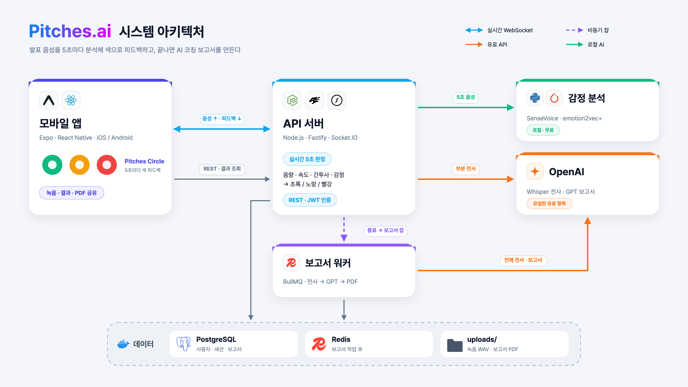
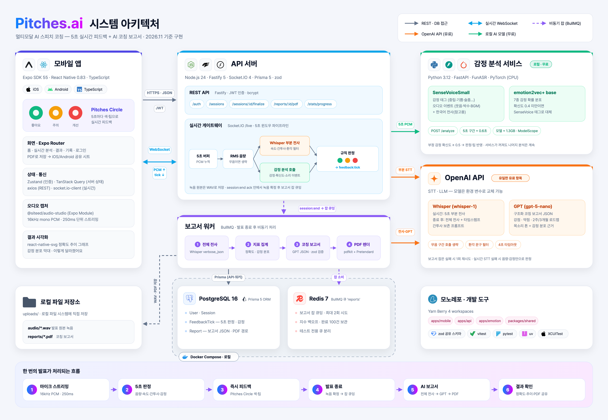
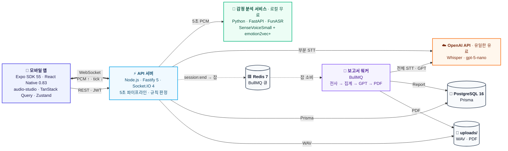
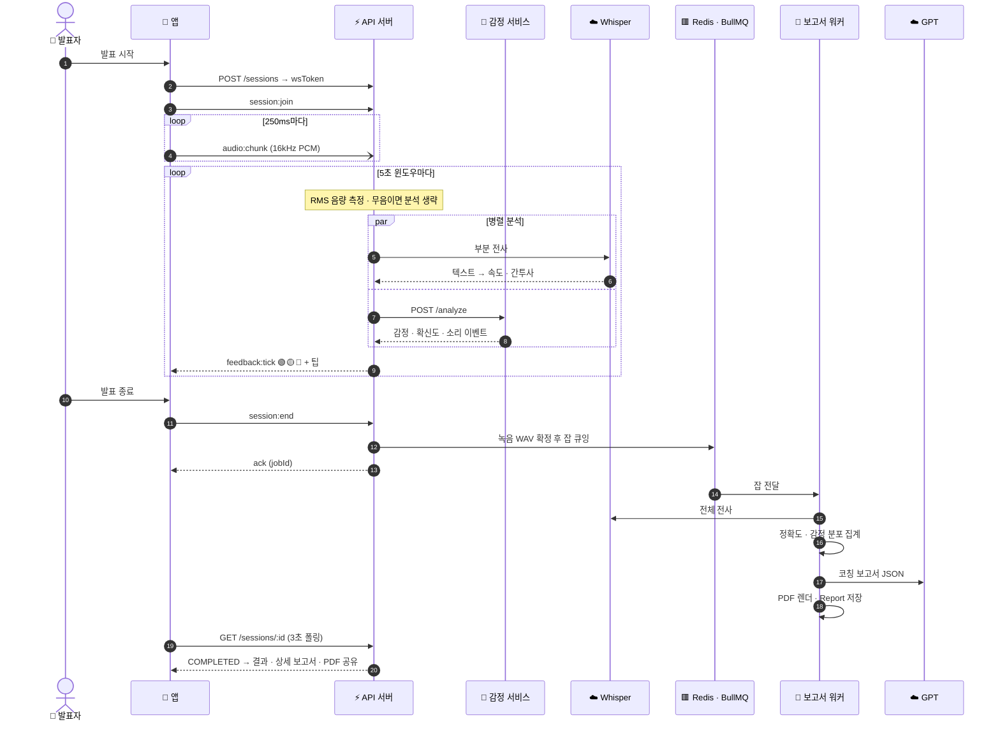

# Pitches.ai 시스템 아키텍처

> 2026-11 기준 구현 상태. SVG 는 편집용(Pretendard 폰트가 설치돼 있어야 그대로 보임), 공유할 때는 PNG 권장.

| 버전 | 용도 | 파일 |
|---|---|---|
| 간소화 (16:9) | 발표 슬라이드 · 한눈에 보기 | [`pitches-architecture-simple.png`](./pitches-architecture-simple.png) (3840×2160) · [`svg`](./pitches-architecture-simple.svg) |
| 상세 | 기술 문서 · 개발 참고 | [`pitches-architecture.png`](./pitches-architecture.png) (4800×3320) · [`svg`](./pitches-architecture.svg) |

상세 버전 보기

## Mermaid

GitHub · Notion · VS Code 미리보기에서 바로 렌더링된다.

### 구성도

### 발표 한 번의 시퀀스

## 한 번의 발표가 처리되는 흐름

1. **마이크 스트리밍** — 앱이 16kHz mono PCM 을 250ms 단위로 Socket.IO `/live` 에 보낸다.
2. **5초 판정** — 게이트웨이가 5초씩 모아 RMS 음량을 재고, 무음이 아니면 Whisper 부분 전사(속도·간투사)와 감정 서비스(감정·확신도·소리 이벤트)를 병렬 호출한다.
3. **즉시 피드백** — 이슈 0개 초록, 1개 노랑, 2개 이상 빨강. `feedback:tick` 으로 앱의 Pitches Circle 과 팁이 바뀐다.
4. **발표 종료** — `session:end` ack 안에서 녹음 WAV 를 확정하고 BullMQ 잡을 큐잉한다.
5. **AI 보고서** — 워커가 전체 전사 → 지표 집계(정확도·감정 분포) → GPT JSON 보고서 → PDF 를 만든다.
6. **결과 확인** — 앱이 결과·정확도 추이·상세 보고서를 보여주고 PDF 를 공유 시트로 내보낸다.

## 구성 요소

| 구성 요소 | 하는 일 | 기술 |
|---|---|---|
| 모바일 앱 | 녹음·스트리밍, Pitches Circle 실시간 피드백, 결과·기록·PDF 공유 | Expo SDK 55 · React Native 0.83 · @siteed/audio-studio |
| API 서버 | 인증·세션 REST, 실시간 게이트웨이(5초 판정), 보고서 잡 등록 | Node.js · Fastify 5 · Socket.IO 4 · Prisma 5 |
| 감정 분석 서비스 | 5초 음성의 감정·확신도·소리 이벤트 | Python · FastAPI · SenseVoiceSmall · emotion2vec+ |
| 보고서 워커 | 전체 전사 → 지표 집계 → GPT 보고서 → PDF | BullMQ · pdfkit + Pretendard |
| OpenAI | 음성 전사, 코칭 보고서 생성 (유일한 유료 항목) | Whisper · gpt-5-nano |
| 데이터 | 사용자·세션·판정·보고서 / 작업 큐 / 녹음·PDF 파일 | PostgreSQL 16 · Redis 7 · 로컬 `uploads/` |
| 공유 스키마 | 앱과 서버가 같은 이벤트·DTO·임계값을 씀 | `packages/shared` (zod) |

## 설계 판단

1. **판정은 서버에서, 규칙 기반으로.** 앱은 녹음·전송·표시만 한다. 속도 220~340자/분, 음량 -35dB, 5초당 간투사 1개 초과, 부정 감정 중 걸린 이슈 개수로 초록/노랑/빨강을 정한다. 임계값을 바꿔도 앱을 다시 배포할 필요가 없고, 왜 그 색인지 팁으로 설명할 수 있다.
2. **실시간은 Socket.IO, 나머지는 REST.** 250ms 음성 업로드와 5초 피드백이 양방향으로 오가서 WebSocket을 쓰고, 세션 생성·결과 조회는 재시도와 캐시가 쉬운 REST로 둔다. Socket.IO 서버는 연결이 끊긴 뒤 도착한 이벤트를 버리므로, 앱은 `session:end` ack 를 받은 뒤에 끊고 실패하면 REST `finalize` 로 대신한다.
3. **피드백은 멈추지 않는다.** 음량은 즉시 계산하고 Whisper(4초)와 감정 분석(3초)은 병렬로 시간 제한을 둔다. 둘 중 하나가 늦거나 실패해도 남은 지표로 5초마다 판정을 낸다.
4. **무음은 분석하지 않는다.** -50dB 미만이면 STT·감정 호출을 건너뛰어 비용을 아끼고, 무음에서 Whisper 가 지어내는 문구("시청해주셔서 감사합니다" 등)는 걸러낸다. 간투사를 지우지 않도록 Whisper 에 간투사가 섞인 예시 프롬프트를 준다.
5. **감정 분석은 별도 Python 서비스로, 로컬 CPU에서.** 모델 생태계(FunASR·PyTorch)가 Python 이고, 무거운 모델을 API 프로세스와 분리하며, 비용이 들지 않는다. 꺼져 있어도 나머지 기능은 그대로 동작하는 선택 의존성이다. emotion2vec+ 확신도가 0.4 이상이면 그 감정을, 아니면 SenseVoice 태그를 쓰고, 색 판정에는 확신도 0.5 이상인 부정 감정만 반영한다.
6. **보고서는 비동기 큐로.** 전체 전사·GPT·PDF 는 수십 초가 걸려 요청 경로에서 떼어 BullMQ 워커가 처리한다. 실패하면 한 번 더 시도하고, 워커만 따로 늘릴 수 있다. 녹음 파일이 확정된 뒤에만 잡을 등록하고, 앱은 3초마다 상태를 확인한다.
7. **LLM 출력은 스키마로 강제.** JSON 모드로 받고 zod 로 검증해 어긋나면 한 번 다시 요청한다. 모델은 환경 변수로 바꿀 수 있다.
8. **PDF는 서버에서 렌더.** Pretendard 를 임베드해 기기와 상관없이 같은 한글 PDF 를 만든다.
9. **유료는 OpenAI 하나.** DB·Redis 는 Docker 로컬, 파일은 로컬 디스크, 감정 모델도 로컬이다.
10. **모노레포 + 공유 스키마.** Yarn Berry 4 workspaces 로 앱·API·감정 서비스·공유 스키마를 한 저장소에 두고, `@pitches/shared`(zod)로 소켓 이벤트·DTO·임계값을 앱과 서버가 함께 쓴다. React Native 번들러 호환을 위해 `node-modules` 링커를 쓴다.
11. **외부 호출 없이 테스트한다.** 파이프라인의 Whisper·감정 호출을 주입할 수 있게 해서 단위 테스트는 외부를 부르지 않는다. 통합 테스트는 STT·감정을 끄고 전용 큐를 쓰며, 앱 화면은 XCUITest 로 확인한다.

## 알려진 한계

- **수평 확장:** 5초 버퍼와 녹음 스트림이 API 프로세스 메모리에 있다. API 서버를 여러 대로 늘리려면 sticky session 이나 외부 저장소가 필요하다.
- **재접속:** 연결이 끊긴 뒤 다시 붙어도 녹음을 이어 붙이지 않는다. 보존된 녹음으로 분석만 할 수 있다.
- **감정 오탐:** 말소리 없는 작은 소음(약 -47dB)도 감정으로 판정한다(화남·기쁨 오탐 확인). 음량 기준 미만에서는 감정 판정을 빼야 한다.
- **OpenAI 의존:** 크레딧 소진이나 장애 시 속도·간투사 판정과 보고서가 멈춘다. 음량·감정 피드백은 계속된다.
- **스토리지 교체:** `Storage` 인터페이스는 만들어뒀지만 아직 연결되지 않았다. 녹음과 PDF 는 파일 시스템에 직접 저장하므로, S3 등으로 바꾸려면 먼저 이 인터페이스로 옮겨야 한다.
